# excalidraw-dashboard architecture

excalidraw-dashboard is a self-hosted Excalidraw for one user, with a list of
named drawings. A React client embeds `@excalidraw/excalidraw` and autosaves
each drawing to a small Hono server, which stores it in SQLite through
`node:sqlite`. Node 24 runs the server's TypeScript directly; only the client
has a build step. Each drawing can have a preview image, whose URL carries a
version ([ADR 0001](adr/0001-version-preview-urls.md)), and any number of tags.
Numbered migrations keep the database schema up to date
([ADR 0002](adr/0002-number-schema-migrations.md)).

## Domain language

- **Drawing**: an entity with an ID, a name, timestamps, a scene and a set of tag
  IDs. It is the aggregate root: its name, scene, preview and tags change only
  through the drawing. Assigning tags isn't an edit, so it leaves `updatedAt`
  alone.
- **Scene**: a value object, the Excalidraw scene serialized with
  `serializeAsJSON(..., "local")`. It matches an exported `.excalidraw` file. A
  new drawing has no scene yet.
- **Preview**: a PNG image of a drawing's scene. It is a value object that
  belongs to the drawing; setting a new one replaces it. `previewUpdatedAt`
  records when it was last set.
- **Drawing summary**: a drawing without its scene or preview image, as a card
  on the landing page shows it. It carries the drawing's tag IDs.
- **Tag**: an entity with an ID, a label, a colour and a creation time, and the root of its own
  aggregate. Tags belong to the dashboard, not to one drawing; a drawing refers
  to them by ID. A label is trimmed, 1 to 30 characters long and unique when
  case is ignored. The colour is one of 8 open-color hues. Tags are dashboard
  data: they live in the database and never in a scene, so an exported
  `.excalidraw` file carries none. `createdAt` is set once, on create, and no
  change touches it.
- **Tag filter**: the tags the user selected on the landing page, in the order
  selected. A drawing matches when it carries any of them; no selected tag
  matches every drawing. The search narrows the matches by name.

## Context

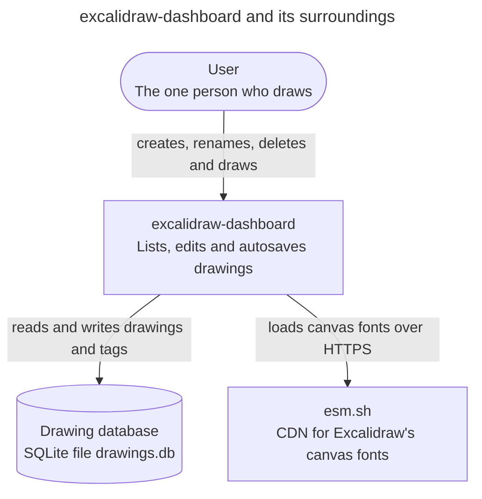

Excalidraw's code is bundled into the client, so it isn't an external system.
Its canvas fonts are not: no asset path is set, so Excalidraw loads them from
esm.sh when the canvas shows text.

The database holds every drawing and tag. A file copy of `DATA_DIR` is a
consistent backup only while the server is stopped; a live backup uses SQLite's
`VACUUM INTO`. The browser stores nothing; the URL names the open drawing. The tag
filter and the search live in the client's memory, so a reload clears them.

## Processes

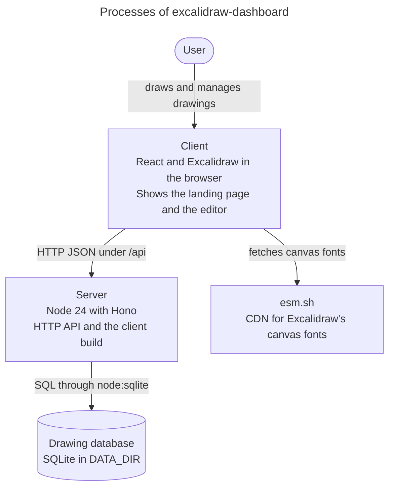

In development, `pnpm dev` starts the server with `node --watch` and the Vite
dev server for the client, which proxies `/api` to the server. In production,
the server also serves the Vite build from `./dist` and answers every other path
outside `/api/` with `index.html`, so the client handles its own URLs, such as
`/drawings/<id>`. An unknown path under `/api/` gets a 404. The
[`Dockerfile`](../../Dockerfile) packages this production server: it builds the
client in one stage and runs `src/server/index.ts` on Node 24 as the `node`
user, with the database in `/data`.

## Modules and dependencies

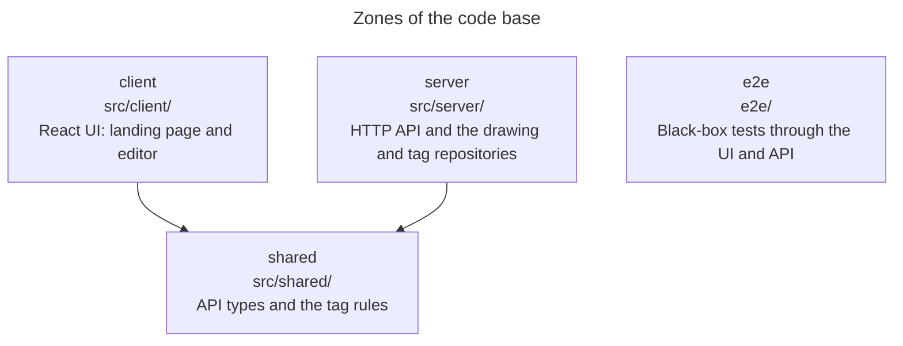

The Fallow zones in [`.fallowrc.json`](../../.fallowrc.json) enforce these
rules, and `pnpm fallow:architecture` fails on a forbidden import. `e2e` may
import nothing from `src/`. The client and the server import `shared` through
the `#shared/*` subpath import in [`package.json`](../../package.json), such as
`#shared/tags.ts`. Node, TypeScript, Vite, Vitest and Fallow all resolve it from
that one entry, so the server still runs its TypeScript without a build. Biome's
`noRestrictedImports` rule rejects a relative import of `shared`. Imports
inside the client stay relative, so they show where a feature lives.

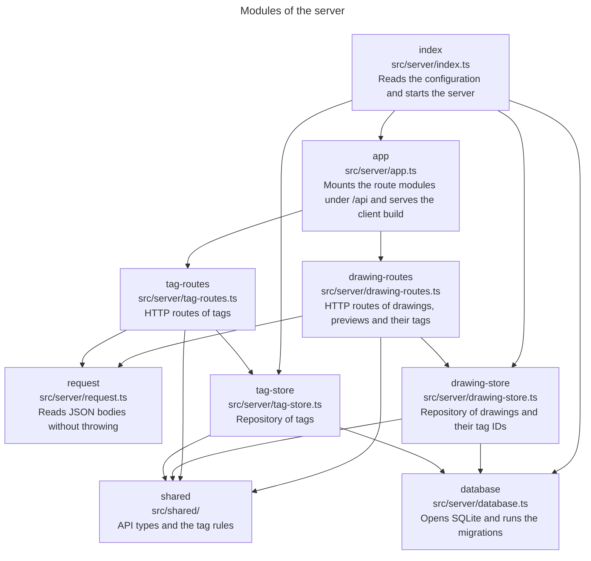

`database` opens the SQLite file and brings its schema up to date. Each
migration runs once, in its own transaction, and `PRAGMA user_version` records
the last one ([ADR 0002](adr/0002-number-schema-migrations.md)). `drawing-store`
and `tag-store` are the repositories; apart from the migrations, no other module
contains SQL. `index` opens one database and hands it to both.

A drawing row holds the name, the timestamps, the scene as JSON text and the
preview as a BLOB. Only the preview route reads the BLOB. The `drawing_tags`
table holds which drawings carry which tags. It belongs to the drawing aggregate,
so `drawing-store` writes it, and the summary queries read the tag IDs from it.
Its foreign keys delete a drawing's rows when the drawing or the tag goes.
`tag-store` owns the `tags` table, whose `label_key` column holds the label in
lower case under a `UNIQUE` constraint, and a `created_at` column with the
creation time. Migration 3 added the column; it gave existing tags times that
follow their insertion order. `GET`, `POST` and `PUT` return `createdAt`, and the
list stays sorted by label.

Each aggregate has one route module. `drawing-routes` serves the drawing, its
preview and its set of tag IDs, and checks the tag IDs and the preview's type and
size. `tag-routes` serves the tags and checks their bodies against the rules in
[`src/shared/tags.ts`](../../src/shared/tags.ts), which the client checks too
before it sends a change. `app` mounts both under `/api`, answers any other API path with 404 and
serves the client build. `index` is the composition root and holds no logic
worth testing. Nothing enforces the dependencies inside the server beyond code
review.

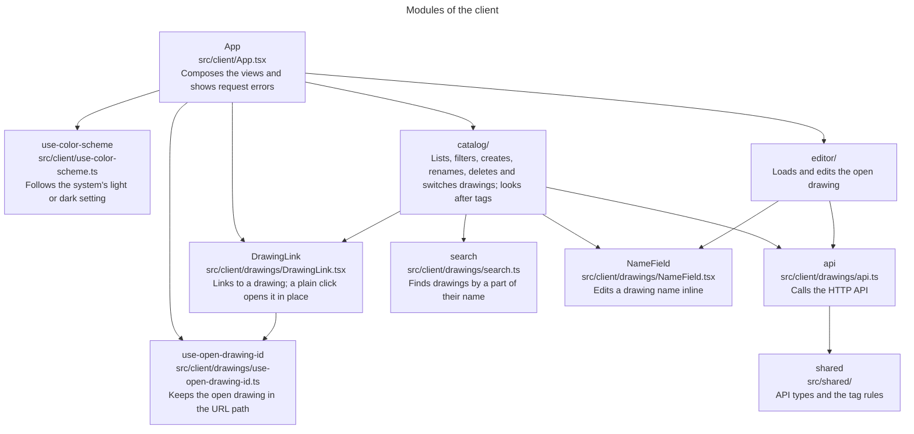

[`src/client/main.tsx`](../../src/client/main.tsx) is the composition root: it
renders `App` and loads `styles.css`. `src/client/drawings/` is the drawings
feature, one bounded context around the `Drawing` aggregate. It has two modules:
`catalog/` lists, filters, creates, renames, deletes and switches drawings and looks
after tags, and `editor/` edits the
open one and keeps its scene and preview saved. They don't import each other;
both use `api.ts` at the root. `search.ts`, a domain service that finds
drawings by a part of their name, sits at the root too, with `NameField`, which
renames a drawing on its card and in the editor bar, and `icons`, the line icons
of both modules and `App`. So does
`use-open-drawing-id.ts`,
and `App` uses it to track the open drawing: `/drawings/<id>` opens a drawing,
and `/` opens none. `App` shows the landing page at `/` and the editor view
otherwise: the editor below a bar with an "All drawings" link, the drawing's
name, which renames the drawing, and its tags, which change them. Cards and "All
drawings" are `DrawingLink`s: real links to a drawing's path, so a middle click
opens a new tab, while a plain click opens the drawing without loading the page.
Any client module may import `shared`; the diagrams show only `api`, the main
user. Nothing enforces the dependencies inside the client beyond code review.

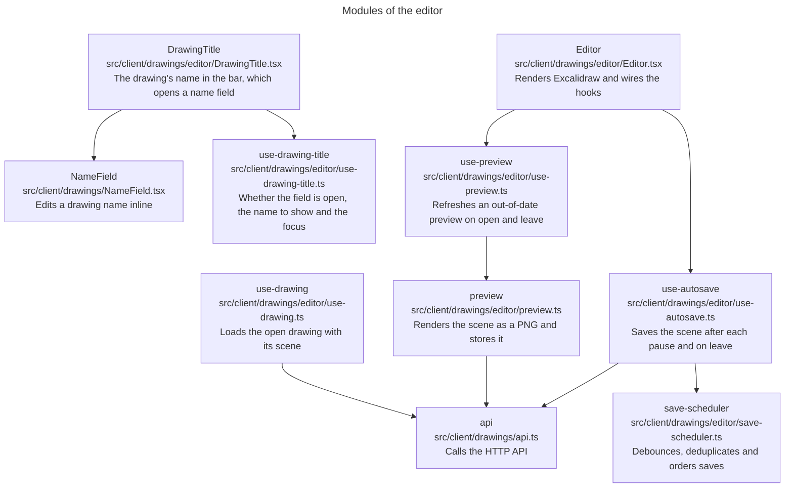

`App` loads the open drawing with `use-drawing` and renders `Editor` with it.
`Editor` only renders Excalidraw; the two hooks hold its behavior. `use-preview`
gets the saved scene from `use-autosave` through `settle`, which `Editor` passes
in, so it doesn't import `use-autosave` beyond a type. A preview is out of date
when the drawing has none or when it's older than the last scene save, and only
then is it rendered: a light PNG, at most 640 px on the longer side, from
Excalidraw's `exportToBlob`. A scene with nothing visible removes the preview. A
failed preview is only logged, and the next open tries again.

The bar shows the drawing's name through `DrawingTitle`. `App` gives it the name
from `use-drawings`, not the one `use-drawing` loaded, so a rename shows in the
bar and on the card alike. Clicking the name opens `NameField` in its place,
with the same type and box, so the bar doesn't move. `App` renames through
`use-drawings`. While the rename saves, `use-drawing-title` shows the new name,
so the bar never falls back to the old one before the list has the new one; a
failed rename shows the old name and `App`'s error message. After Enter or
Escape the focus goes back to the name; a click elsewhere leaves the focus where
the user clicked. Renaming doesn't touch the scene, so autosave goes on while
the field is open.

After the name, `App` renders `DrawingTagsButton` from `catalog/tags/` with the
drawing as `use-drawings` has it and the tags from `use-tags`, so the bar shows
a tag change at once, like the card. It shows the first three tags as on a card,
with the card's tilt, then "+2" for the rest; on a narrow screen only a tag icon
and the count. Without tags it shows only the icon. When the name and the tags
don't both fit, each gets half the room, and a short one keeps its full width. A click opens
`DrawingTagsDialog`, the dialog the card opens, and `App` gives or takes off a
tag through `use-drawings`. While the tags load or after they failed to load,
the bar shows none.

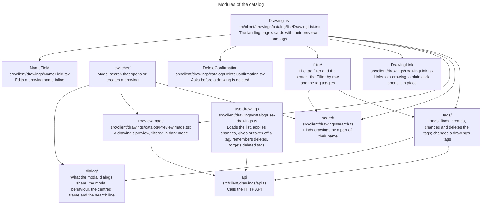

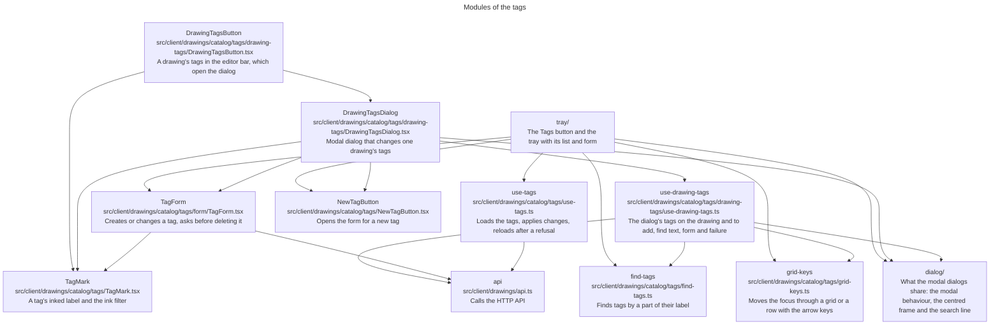

`list/` holds the landing page, `filter/` the tag filter, `switcher/` the quick
switcher, `tags/` the tags and `dialog/` what the modal dialogs share: `use-modal-dialog`,
`SearchLine`, a search field on a notebook line with no box, and
`CentredDialog.module.css`, the frame of the quick switcher and the dialog for a
drawing's tags: a sheet in the middle of the window over the dimmed page. Directly in `catalog/`
stay `PreviewImage`, which the landing page and the quick switcher use,
`use-drawings` for `App`, and `DeleteConfirmation`, which only `DrawingList` uses
today but which doesn't depend on it. The diagrams leave out `icons`, the line
icons at the root of `drawings/` that `list/`, `switcher/`, `tags/`, `dialog/`,
`DrawingTitle` and `App` take, since it depends on nothing.

`tags/` has one folder per UI unit, each with its hook, CSS module and tests:
`tray/` holds `TagTray` and `use-tag-tray`, `drawing-tags/` holds
`DrawingTagsDialog`, `use-drawing-tags` and `DrawingTagsButton`, which opens the
dialog from the editor bar, and `form/` holds `TagForm` and
`use-tag-form`. What several units use stays at the top of `tags/`: `use-tags`,
`TagMark`, `NewTagButton`, `find-tags`, `grid-keys` and `tag-color-name`.

`App` renders `DrawingList` with the list from `use-drawings`, the tags from
`use-tags` and the filter from `use-tag-filter`. The first card
is a blank sheet that asks for a name and opens the new drawing. Every other
card shows the drawing's preview on a sheet, with an `` whose URL from
`api.ts` carries `previewUpdatedAt` as a version. A drawing without a preview,
or one whose preview fails to load, shows a blank sheet. Leaving a drawing
sends its new preview's summary to `use-drawings`, so the card changes its URL
and the browser loads the new image. A card renames its drawing through
`NameField` and deletes it only after `DeleteConfirmation`. `use-drawings`
remembers which drawings it deleted, so `App` can ignore a last save that was
still in flight and fails once the drawing is gone.

`tags/` holds the tag aggregate's part of the catalog. `use-tags` loads the tags
once when `App` mounts and sorts them with `localeCompare`, as `use-drawings` sorts
names, so a label such as "Ärger" sits with the A's and not after "Work". The
**Tags** button next to the search opens `TagTray`, a native modal `<dialog>` below
the button with a transparent backdrop, so the page stays in view but can't scroll
([ADR 0003](adr/0003-tag-tray-as-modal-dialog.md)). The tray lists each tag with
its colour and the number of drawings that carry it, which it counts from the
drawing summaries. Its field finds tags through `find-tags`, a domain service:
labels that start with the text first, then the rest. A status
says when no tag has the text, when there are no tags yet or when they aren't
loaded, and announces what a change did. Tab reaches one row, and the arrow keys
move through the others with `grid-keys`. The tray ends above the window's foot, and
in a short window its rows or its form scroll inside it.

Each row's pencil, the **New tag** button and Enter on a text nothing matches swap
the list for `TagForm`, which knows nothing of the tray, so another dialog can host
it. `use-tag-form` holds its state, and `tag-color-name` gives it and the tray the names
of the colours. It shows the tag
as a `TagMark`, whose worn edge comes from the `TagInkFilter`
that `DrawingList` renders once. On submit the form checks the label against the
rules in `src/shared/tags.ts` and the loaded tags, in the words the server would
use. A change the client let through can still be refused, when another tab changed
the tags. `api.ts` then throws an `ApiError` with the status and the server's text,
and each answer has its own path:
- A 400 or 409 shows the server's text in the form. On a 409 `use-tags` also reloads
  the list.
- A 404 means the tag is gone. `use-tags` reloads the list and the tray goes back
  to it and says so.
- Anything else, such as a 5xx or no connection, says in the form that the change
  failed, and the form or the delete question stays open to try again. `App`'s error
  banner would sit behind the modal tray.

A card shows its drawing's first 3 tags by label as small `TagMark`s along the foot
of its sheet, and `+N` as plain text for the rest. The card's link names every tag,
as in "Plan, tags: Home, Work". The tags are buttons of the tag filter, described
below. The card's tag button opens `DrawingTagsDialog`, a modal `<dialog>` in `CentredDialog`'s frame for
that drawing. `use-drawing-tags` holds its state. The tags the drawing has stand
on top, and a click takes one off. The tags it hasn't, found by label through
`find-tags`, stand below the find field; a click adds one, and Enter adds the top
match. Enter on a text no tag to add has, or the `NewTagButton` the tray shares,
swaps the list for `TagForm`, and saving creates the tag and adds it. A label the
drawing already has opens no form; the status says so. The status also announces
each tag added or removed, as the button moves out of the focus. Escape undoes
the form, then the find text, then closes the dialog, and the browser returns the
focus to the card's tag button.

Each add or remove calls `toggleTag` in `use-drawings`, which changes the summary
at once and sends the drawing's whole set of tag IDs with `setDrawingTags`. A second
click before the server answers builds on the first. If the server refuses,
`toggleTag` undoes only that change and rejects, and the dialog says why: a 400 or
404 means another tab changed the drawing or the tags, so it asks for a reload, and
anything else asks to try again.

`use-tags` applies every answer to its sorted list. It reports a tag that is gone,
deleted here or elsewhere, to `use-drawings`, whose `forgetTag` takes the ID off
the drawing summaries, as the server already did.

Escape undoes one layer at a time: the delete question, the form, the find text,
then the tray. A press beside the tray closes it, and the focus returns to the
button. Saving focuses the tag's pencil, and deleting focuses the find field.

`QuickSwitcher` keeps its dialog, query, rows and selection in
`use-quick-switcher`, which finds the drawings through `search.ts`. The editor
view's bar has a "Switch drawing" button, and `use-switcher-shortcut`
makes Ctrl+K or ⌘K toggle the same `QuickSwitcher` while the editor view is
mounted. The hook listens in the capture phase and stops the event, so Excalidraw
doesn't add a link on those keys. The switcher belongs to the catalog even though
it shows over the editor, because it finds and creates drawings. It is a native
modal `<dialog>`: the browser shows it above Excalidraw's layers, makes the page
behind it inert and returns the focus when it closes. It stops key events at the
dialog, and it sits outside Excalidraw's container, so they don't reach
Excalidraw's shortcuts. It lists the
matches from `search.ts` by `updatedAt`, newest first, and last offers to create
the query as a new drawing unless a drawing has that name. Choosing a row calls
`App`, which opens or creates the drawing as the landing page does. The editor
remounts on `key={drawing.id}`, so its pending save is flushed as when leaving
through "All drawings".

`filter/` holds the tag filter. `use-tag-filter` keeps the selected tag IDs in the
order selected and the search query. `App`
calls it, not `DrawingList`, so the filter and the search stay set while a drawing
is open and come back with the landing page. Nothing stores them, so a reload
clears them. The hook derives its tags from the loaded ones on each render, so a
deleted tag leaves the filter and the row, and a renamed one shows its new label.
`tag-filter` is a domain service: `filterDrawings` keeps the drawings that carry any
selected tag and narrows them by name through `search.ts`. `newestFirst` orders the
tags of the "Filter by" row by `createdAt`, newest first, with the label breaking a
tie. The order depends only on the loaded tags, so a tag moves only when a tag is
created, which then comes first, or deleted.

`FilterRow` is the "Filter by" toolbar between the header and the cards. It shows
every tag, newest created first, and a **Clear filter** button while a filter is
set. A click on a tag only turns it on or off and never moves it, and clearing the
filter moves nothing either. Solid ink alone marks a selected tag. Its tags are
medium `TagMark`s, between a card's and the tray's in size, so a finger hits them
on a phone. The row is one line of fixed height and stays blank without tags, so
the cards don't move when tags arrive. Its tags scroll sideways when they don't fit. The CSS module fades the
edge where tags are cut off and nowhere else, with scroll-driven animations of two
registered fade widths and no script. A browser without them shows no fade.

`TagToggles` renders tags as toggle buttons named `Filter by <label>` with
`aria-pressed`, and a selected one as a solid `TagMark`, inked in its
`--tag-<colour>-fill` under paper-coloured words. The caller picks the mark size:
small on a card, medium in the row. Each button reaches past its mark, so it is
easier to hit than the mark looks. The row and each card use it as
a toolbar with one tab stop; the left and right arrow keys move through its tags with `moveInRow` from
`grid-keys`. A card's toggles lie over the foot of its sheet but outside its link,
so a click filters and doesn't open the drawing. A card shows its first 3 tags in
label order, and a click doesn't move one. `shownCardTags` in `list/card-tags.ts`
gives a selected tag that would hide behind `+N` the slot of the last shown tag
that isn't selected, and keeps the shown tags in label order. After a toggle, `use-tag-refocus` in
`list/` keeps the focus on the tag: on the same card if it still shows there, else
in the row. When the card's tags dialog takes the card off the page, such as by
removing the tag the filter shows it for, the browser has no tag button to return
the focus to, so `DrawingList` gives it to the **Tags** button. Changing the filter
or the search closes a card's rename or delete question.

In the tray, each row's swatch, label and count form one toggle button, and the
pencil stays beside it; the arrow keys move through both. A pressed row takes the
tag's `--tag-<colour>-fill`. Enter in the find field
toggles the top match and announces it, or opens the form when no tag matches. The
footer offers **Clear filter** while a filter is set, and the **Tags** button shows
how many tags are selected, as in "Tags, 2 in the filter".

`DrawingList` shows the drawings from `filterDrawings`. When none shows, the status
says why through `no-match-message`: no drawing has the selected tags, no drawing
has the name, or no drawing in the filter has it while some outside it do, as in
"No drawing with Work or Home is named “plan”. 2 drawings without these tags are."
In the last case a **Clear filter** button follows, which keeps the search.

[`styles.css`](../../src/client/styles.css) holds what the whole client shares:
design tokens for colors from open-color, the palette Excalidraw draws with, and
for font sizes, line heights, font weights, stroke widths, corner radii and
spacing, with a `--tag-<colour>-solid`, a `--tag-<colour>-ink` and a
`--tag-<colour>-fill` for each of the 8 tag colours in both palettes. Solid is for a
mark on its own, ink for a label in the tag's colour, and fill for a tag in the
filter, under `--sheet`-coloured words;
Excalidraw's bundled fonts, Excalifont for drawing names and Assistant for
controls; the base rules; and the focus ring. It switches to a dark palette with
`prefers-color-scheme`. Each component keeps its own rules in a CSS module next
to it, such as `DrawingList.module.css`, so its class names can't clash with
another component's. `PreviewImage`'s module gives previews, which are stored
light, Excalidraw's own canvas filter in dark mode. `use-color-scheme` reads the
same setting for `App`, which passes it to `Editor`. `Editor` hands it to
Excalidraw and hides Excalidraw's own theme toggle. The theme is display state
only: Excalidraw leaves it out of the stored scene, so a theme change saves
nothing.

## Runtime flow

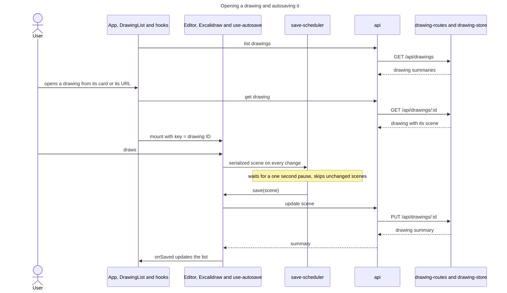

`App, DrawingList and hooks` folds `App`, `DrawingList`, `use-drawing` and
`use-drawings` into one lane.
`save-scheduler` imports nothing; `use-autosave` gives it the function that
saves. Going back to all drawings or leaving the page flushes a pending save,
and reopening the drawing loads its scene again. Saves run one at a time: the
server keeps whichever write lands last, so a newer scene waits for the save in
flight.

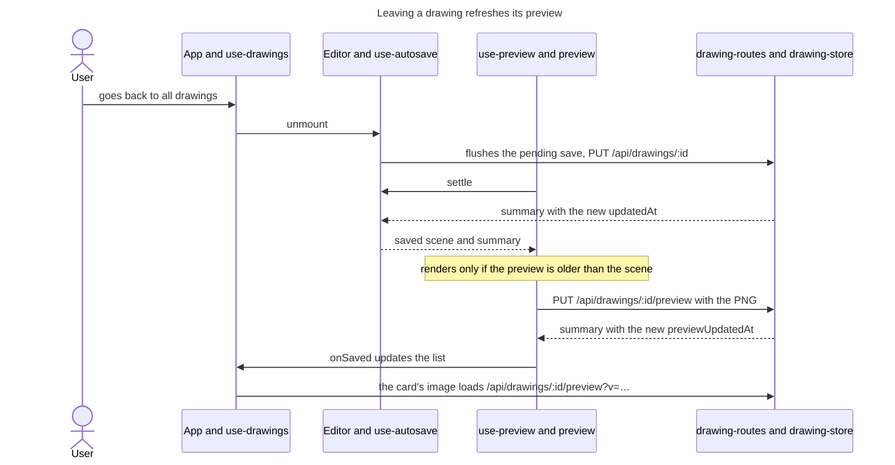

The same check runs when a drawing opens, which gives drawings saved before
previews existed a preview and repairs one a closed tab left out of date. The
browser seldom finishes an export during `pagehide`, so that path is best
effort. Both lanes call the server through `api`, which this diagram leaves out.

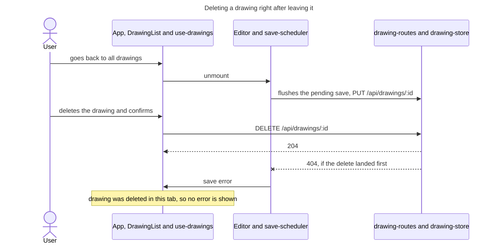

Both lanes call the server through `api`, which this diagram leaves out. A save
that fails because another tab deleted the drawing still shows an error, because
the edit is lost.

## HTTP API

| Route                       | Method | Purpose                                         |
| --------------------------- | ------ | ----------------------------------------------- |
| `/api/drawings`             | GET    | List drawing summaries, sorted by name          |
| `/api/drawings`             | POST   | Create a drawing; a blank name becomes Untitled |
| `/api/drawings/:id`         | GET    | Get a drawing with its scene                    |
| `/api/drawings/:id`         | PUT    | Change the name, the scene or both              |
| `/api/drawings/:id`         | DELETE | Delete a drawing                                |
| `/api/drawings/:id/preview` | GET    | The PNG preview, cached as immutable            |
| `/api/drawings/:id/preview` | PUT    | Store an `image/png` body of at most 2 MB       |
| `/api/drawings/:id/preview` | DELETE | Remove the preview                              |
| `/api/drawings/:id/tags`    | PUT    | Replace the drawing's tags with `{ tagIds }`    |
| `/api/tags`                 | GET    | List tags, sorted by label with case ignored    |
| `/api/tags`                 | POST   | Create a tag from `{ label, color }`            |
| `/api/tags/:id`             | PUT    | Change a tag's label and colour; both required  |
| `/api/tags/:id`             | DELETE | Delete a tag and remove it from every drawing   |

Unknown drawings, and a drawing without a preview, answer 404. Preview uploads
answer 415 for another content type and 413 above 2 MB. The `PUT` and `DELETE`
on a preview return the drawing summary; they change `previewUpdatedAt`, not
`updatedAt`. Clients are to add `?v=<previewUpdatedAt>` to the preview URL ([ADR
0001](adr/0001-version-preview-urls.md)). Scenes have no body limit, because
scenes with embedded images can be large.

A drawing body that isn't a JSON object, or whose name or scene isn't text,
answers 400 and changes nothing.

An unknown tag in the path answers 404. A tag body that isn't JSON, lacks a
label, breaks the label rules or names an unknown colour answers 400. So does an
assignment body that isn't JSON or lacks an array of tag IDs, and an assignment
with an unknown tag ID, which then changes nothing. A label another tag has,
ignoring case, answers 409. Errors are plain text. `PUT /api/drawings/:id/tags`
returns the drawing summary and leaves `updatedAt` alone; a tag ID sent twice
counts once. Summaries list tag IDs sorted by ID; clients sort them for display.
[`src/shared/drawings.ts`](../../src/shared/drawings.ts) and
[`src/shared/tags.ts`](../../src/shared/tags.ts) hold the request and response
types.

## Configuration

| Variable   | Default  | Purpose                                              |
| ---------- | -------- | ---------------------------------------------------- |
| `PORT`     | `3001`   | HTTP port                                            |
| `DATA_DIR` | `./data` | Directory of `drawings.db`                           |
| `NODE_ENV` | unset    | `production` makes the server serve `./dist` as well |

## Tests and quality gates

Vitest runs three projects from [`vite.config.ts`](../../vite.config.ts):
- `server` tests the API through `app.request` against an in-memory SQLite
  database, including the cascades when a tag or a drawing is deleted. Each
  route module has its own test file, and `app.test.ts` covers the API 404 and
  the client build. `test-api.ts` gives each test a fresh database and holds the
  request helpers. `database.test.ts` opens database files from before numbered
  migrations, with and without previews, in a temporary folder, to test the
  upgrade.
- `shared` tests the tag label and colour rules and their messages.
- `client` tests in jsdom with Testing Library. Component tests mock `api.ts`
  and replace `Editor.tsx`, since Excalidraw does not render in jsdom. The
  editor hooks and `preview.ts` are tested with `api.ts` and Excalidraw's
  `exportToBlob` mocked.

`pnpm check` runs the typecheck, Biome lint and formatting, a Stylelint check
that CSS modules use the design tokens, Vitest, the production build and the
Fallow gates: dead code, duplicates, zone boundaries and health with a CRAP
limit of 12. For health, `pnpm coverage` first writes
`coverage/coverage-final.json`, which Fallow reads for the CRAP scores.

`pnpm mutation` runs mutation testing on changed code against `origin/main` and
fails below the minimum score set in the `mutation` script. CI runs it on pull
requests.

Playwright runs the end-to-end tests in [`e2e/`](../../e2e/) against the real
application: the production build, the server, SQLite and Excalidraw in
Chromium.
- [`playwright.config.ts`](../../playwright.config.ts) builds the client and
  starts the server on port 3101 with `DATA_DIR=.e2e-data`. The folder is
  deleted before each run and kept afterwards for debugging. The tests share
  this server and run one at a time.
- [`drawings.spec.ts`](../../e2e/drawings.spec.ts) covers creating, renaming and
  deleting a drawing, opening one from its card or its URL, retracing drawings
  and the landing page with the browser's back button, a drawing surviving a
  reload, storing a preview when the user leaves a drawing or opens one that has
  none and showing it on the card, reopening a drawing right after leaving it,
  following the system's dark mode, searching the drawings by name with the search
  still set after opening a drawing, and showing a failed save. The reload test reads the saved scene from the API, then
  selects all shapes in the editor to show the scene was loaded back. The
  failed-save test deletes the open drawing through the API, as another tab
  would, then dismisses the error message above the editor. The preview-on-open
  test copies a drawn scene into a drawing created through the API, so that
  drawing has no preview yet.
- [`tags-api.spec.ts`](../../e2e/tags-api.spec.ts) covers tags through the
  HTTP API: creating, renaming and deleting a tag, assigning tags to a drawing
  without changing its `updatedAt`, and that deleting a tag removes it from the
  drawing.
- [`tags.spec.ts`](../../e2e/tags.spec.ts) covers the Tags tray: the rows with
  their colour and drawing count, where the tray hangs on a wide and a phone-width
  window, fitting a short window that can't scroll, finding a tag, using it by keyboard
  alone with the focus returning to the button, and closing it with a press beside
  it. It also creates, renames, recolours and deletes a tag by mouse and by keyboard,
  with the focus after each step, deletes a tag a drawing carries, shows the rejected
  labels, keeps a failed change in the form to try again, follows the server's 409 and 404 after another client changed the tags, and
  keeps the form, a long list with its status line and **New tag** in a short window,
  and ends a long label in an ellipsis on a phone. Preconditions and assignments come from the HTTP
  API.
- [`drawing-tags.spec.ts`](../../e2e/drawing-tags.spec.ts) covers a drawing's
  tags: adding and removing them from the card and seeing them after a reload,
  doing it by keyboard alone with a tag created in place and the focus returning
  to the card, and a card that shows 3 tags and counts the fourth.
- [`tag-filter.spec.ts`](../../e2e/tag-filter.spec.ts) covers the tag filter:
  filtering by a tag on a card and one in the tray, searching inside the filter,
  finding both still set after opening a drawing and returning, a reload that
  clears them, and filtering by keyboard alone with the pressed state of each tag.
- [`app.spec.ts`](../../e2e/app.spec.ts) checks that the page names the
  Excalidraw logo as its icon and that the server serves it as an SVG.
- Each test groups its actions and checks into `test.step` blocks, so the test
  and its report read as a scenario.
- [`drawings-ui.ts`](../../e2e/drawings-ui.ts) holds the locators and user
  actions for the drawings UI, including a card's tags, their dialog and the
  "Filter by" row, and
  [`drawings-api.ts`](../../e2e/drawings-api.ts) creates and deletes drawings,
  stores scenes, assigns tags, and reads stored scenes, previews and summaries
  through the HTTP API. [`tags-api.ts`](../../e2e/tags-api.ts) creates, changes
  and deletes tags and reads them back, and [`tags-ui.ts`](../../e2e/tags-ui.ts)
  holds the locators and user actions for the tray. None of them defines steps. [`unique-name.ts`](../../e2e/unique-name.ts) gives every
  drawing and tag a name no other test uses.

The tests are black-box. They run with `pnpm e2e` and in the `e2e` CI job, not
in `pnpm check`.

## Decisions

The [ADR index](adr/README.md) records the decisions behind this design as they
are made.
