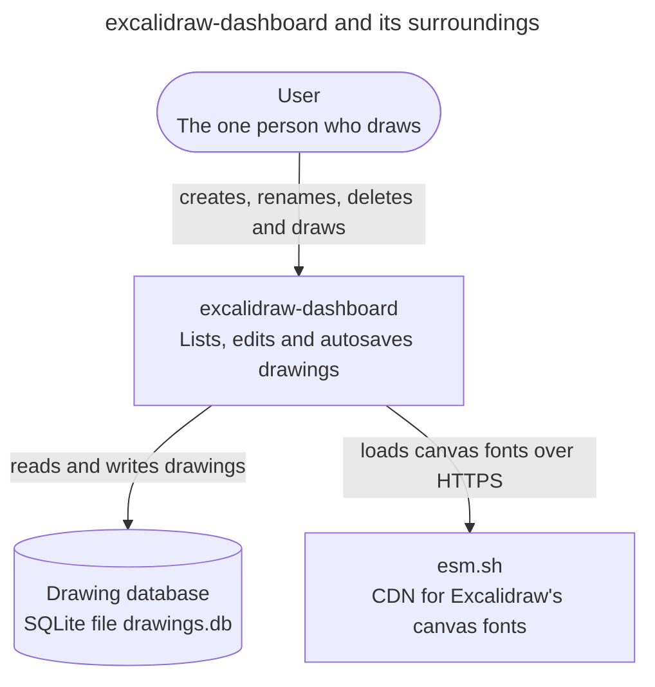
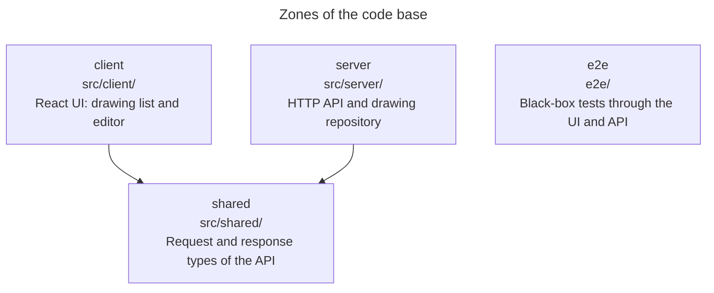
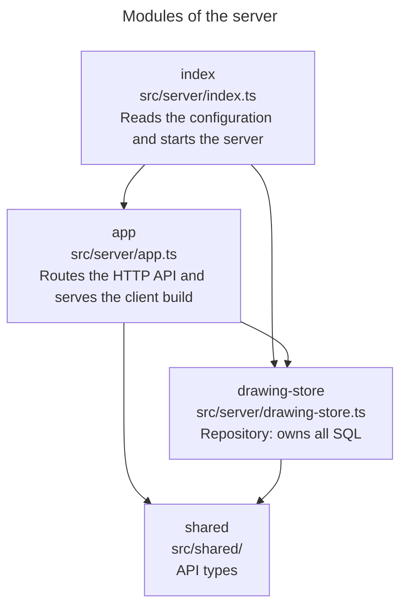
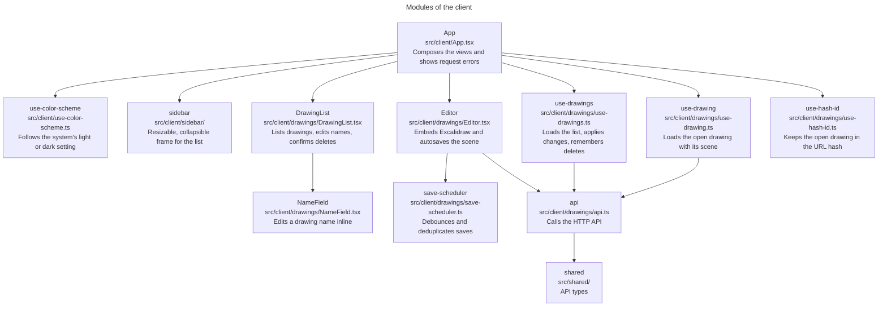
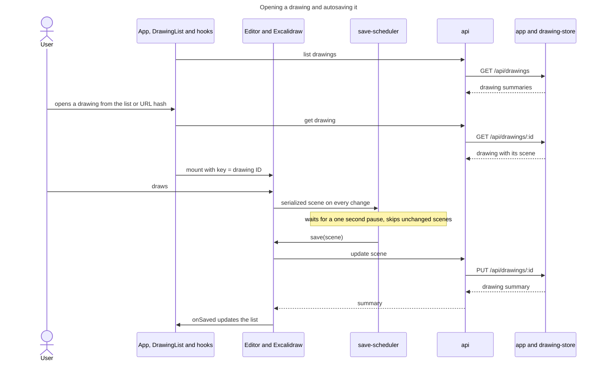
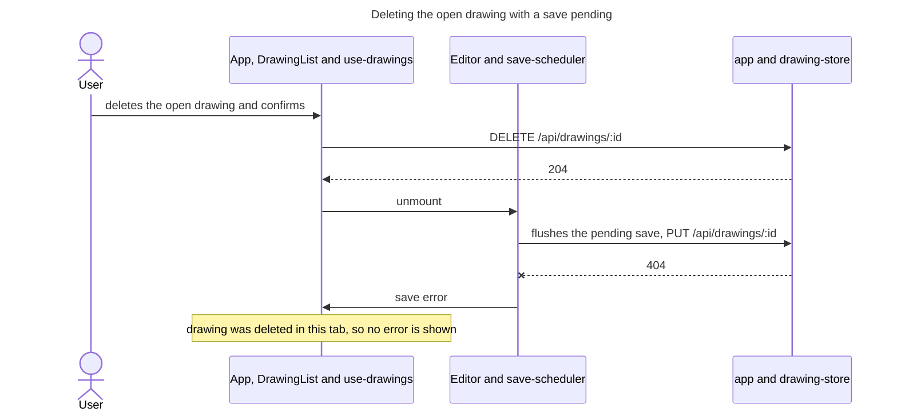

# excalidraw-dashboard architecture

excalidraw-dashboard is a self-hosted Excalidraw for one user, with a list of
named drawings. A React client embeds `@excalidraw/excalidraw` and autosaves
each drawing to a small Hono server, which stores it in SQLite through
`node:sqlite`. Node 24 runs the server's TypeScript directly; only the client
has a build step. Each drawing can have a preview image, whose URL carries a
version ([ADR 0001](adr/0001-version-preview-urls.md)).

## Domain language

- **Drawing**: an entity with an ID, a name, timestamps and a scene. It is the
  aggregate root: its name and scene change only through the drawing.
- **Scene**: a value object, the Excalidraw scene serialized with
  `serializeAsJSON(..., "local")`. It matches an exported `.excalidraw` file. A
  new drawing has no scene yet.
- **Preview**: a PNG image of a drawing's scene. It is a value object that
  belongs to the drawing; setting a new one replaces it. `previewUpdatedAt`
  records when it was last set.
- **Drawing summary**: a drawing without its scene or preview image, as the
  drawing list shows it.

## Context

Excalidraw's code is bundled into the client, so it isn't an external system.
Its canvas fonts are not: no asset path is set, so Excalidraw loads them from
esm.sh when the canvas shows text.

The database holds every drawing. A file copy of `DATA_DIR` is a consistent
backup only while the server is stopped; a live backup uses SQLite's
`VACUUM INTO`. The browser keeps only the sidebar
layout, in `localStorage`.

## Processes

In development, `pnpm dev` starts the server with `node --watch` and the Vite
dev server for the client, which proxies `/api` to the server. In production,
the server also serves the Vite build from `./dist` and answers every other path
with `index.html`, so the client handles its own URLs.

## Modules and dependencies

The Fallow zones in [`.fallowrc.json`](../../.fallowrc.json) enforce these
rules, and `pnpm fallow:architecture` fails on a forbidden import. `e2e` may
import nothing from `src/`.

`drawing-store` is the repository for drawings; no other module contains SQL.
A drawing row holds the name, the timestamps, the scene as JSON text and the
preview as a BLOB. Only the preview route reads the BLOB. When the repository
opens a database created before previews, it adds the missing columns.
`index` is the composition root and holds no logic worth testing. Nothing
enforces the dependencies inside the server beyond code review.

[`src/client/main.tsx`](../../src/client/main.tsx) is the composition root: it
renders `App` and loads `styles.css`. `src/client/drawings/` is the drawings
feature: its components, hooks and API calls sit together. Any client module may
import `shared`; the diagram shows only `api`, the main user. Nothing enforces
the dependencies inside the client beyond code review.

`DrawingList` creates and renames drawings inline through `NameField`, and
deletes one only after a confirmation in its row. `use-drawings` remembers which
drawings it deleted, so `App` can ignore the failed last save of a deleted
drawing.

`sidebar` is [`use-sidebar.ts`](../../src/client/sidebar/use-sidebar.ts), which
keeps the width and collapsed state in `localStorage` and resizes by pointer and
arrow keys, and [`Sidebar.tsx`](../../src/client/sidebar/Sidebar.tsx), which
renders the resize handle and the collapsed rail. `Sidebar` passes the button
that hides it to its content, and `DrawingList` shows it in its header.

[`styles.css`](../../src/client/styles.css) holds the look: colors from
open-color, the palette Excalidraw draws with, and Excalidraw's bundled fonts,
Excalifont for drawing names and Assistant for controls. It switches to a dark
palette with `prefers-color-scheme`. `use-color-scheme` reads the same setting
for `App`, which passes it to `Editor`. `Editor` hands it to Excalidraw and
hides Excalidraw's own theme toggle. The theme is display state only: Excalidraw
leaves it out of the stored scene, so a theme change saves nothing.

## Runtime flow

`App, DrawingList and hooks` folds `App`, `DrawingList`, `use-drawing` and
`use-drawings` into one lane.
`save-scheduler` imports nothing; `Editor` gives it the function that saves.
Switching drawings or leaving the page flushes a pending save.

Both lanes call the server through `api`, which this diagram leaves out. A save
that fails because another tab deleted the drawing still shows an error, because
the edit is lost.

## HTTP API

| Route                       | Method | Purpose                                         |
| --------------------------- | ------ | ----------------------------------------------- |
| `/api/drawings`             | GET    | List drawing summaries, sorted by name          |
| `/api/drawings`             | POST   | Create a drawing; a blank name becomes Untitled |
| `/api/drawings/:id`         | GET    | Get a drawing with its scene                    |
| `/api/drawings/:id`         | PUT    | Change the name, the scene or both              |
| `/api/drawings/:id`         | DELETE | Delete a drawing                                |
| `/api/drawings/:id/preview` | GET    | The PNG preview, cached as immutable            |
| `/api/drawings/:id/preview` | PUT    | Store an `image/png` body of at most 2 MB       |
| `/api/drawings/:id/preview` | DELETE | Remove the preview                              |

Unknown drawings, and a drawing without a preview, answer 404. Preview uploads
answer 415 for another content type and 413 above 2 MB. The `PUT` and `DELETE`
on a preview return the drawing summary; they change `previewUpdatedAt`, not
`updatedAt`. Clients are to add `?v=<previewUpdatedAt>` to the preview URL ([ADR
0001](adr/0001-version-preview-urls.md)). Scenes have no body limit, because
scenes with embedded images can be large.
[`src/shared/types.ts`](../../src/shared/types.ts) holds the request and
response types.

## Configuration

| Variable   | Default  | Purpose                                              |
| ---------- | -------- | ---------------------------------------------------- |
| `PORT`     | `3001`   | HTTP port                                            |
| `DATA_DIR` | `./data` | Directory of `drawings.db`                           |
| `NODE_ENV` | unset    | `production` makes the server serve `./dist` as well |

## Tests and quality gates

Vitest runs two projects from [`vite.config.ts`](../../vite.config.ts):
- `server` tests the API through `app.request` against an in-memory SQLite
  database. `drawing-store.test.ts` opens a database file with the schema from
  before previews, in a temporary folder, to test the upgrade.
- `client` tests in jsdom with Testing Library. Component tests mock `api.ts`
  and replace `Editor.tsx`, since Excalidraw does not render in jsdom.

`pnpm check` runs the typecheck, Biome lint and formatting, Vitest, the
production build and the Fallow gates: dead code, duplicates, zone boundaries
and health with a CRAP limit of 12. For health, `pnpm coverage` first writes
`coverage/coverage-final.json`, which Fallow reads for the CRAP scores.

`pnpm mutation` runs mutation testing on changed code against `origin/main` and
fails below the minimum score set in the `mutation` script. CI runs it on pull
requests.

Playwright runs the end-to-end tests in [`e2e/`](../../e2e/) against the real
application: the production build, the server, SQLite and Excalidraw in
Chromium.
- [`playwright.config.ts`](../../playwright.config.ts) builds the client and
  starts the server on port 3101 with `DATA_DIR=.e2e-data`. The folder is
  deleted before each run and kept afterwards for debugging. The tests share
  this server and run one at a time.
- [`drawings.spec.ts`](../../e2e/drawings.spec.ts) covers creating, renaming and
  deleting a drawing, opening one from the URL hash, a drawing surviving a
  reload, following the system's dark mode, and showing a failed save. The
  reload test reads the saved scene from the API, then selects all shapes in the
  editor to show the scene was loaded back. The failed-save test deletes the
  open drawing through the API, as another tab would, then dismisses the error
  message above the editor.
- Each test groups its actions and checks into `test.step` blocks, so the test
  and its report read as a scenario.
- [`drawings-ui.ts`](../../e2e/drawings-ui.ts) holds the locators and user
  actions for the drawings UI, and
  [`drawings-api.ts`](../../e2e/drawings-api.ts) creates and deletes drawings
  and reads stored scenes through the HTTP API. Neither defines steps.

The tests are black-box. They run with `pnpm e2e` and in the `e2e` CI job, not
in `pnpm check`.

## Decisions

The [ADR index](adr/README.md) records the decisions behind this design as they
are made.
