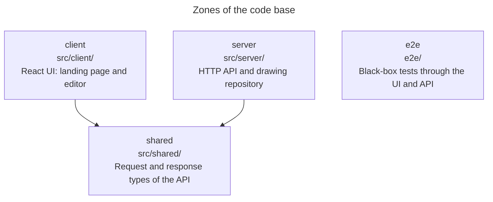
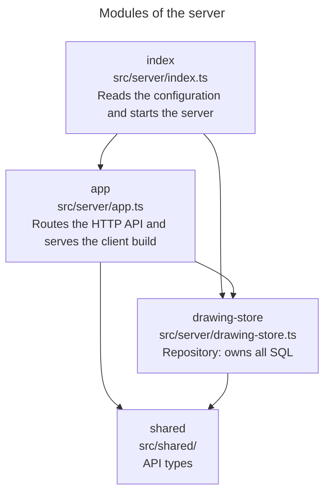
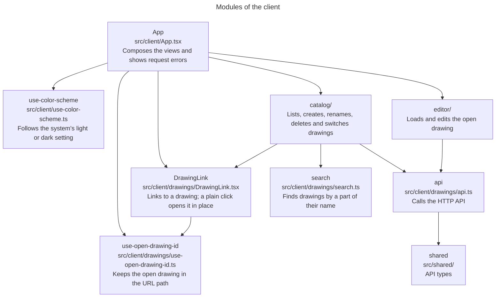
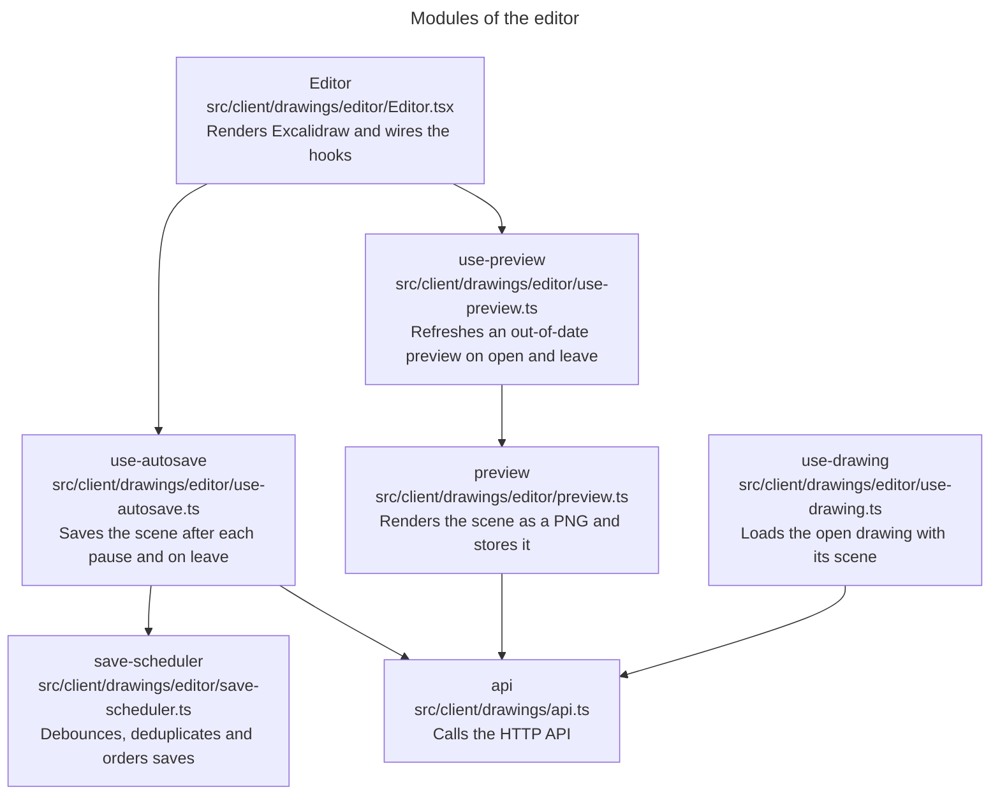
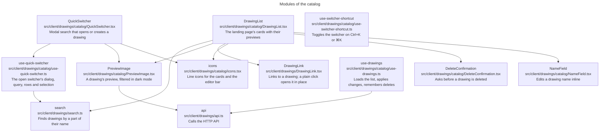
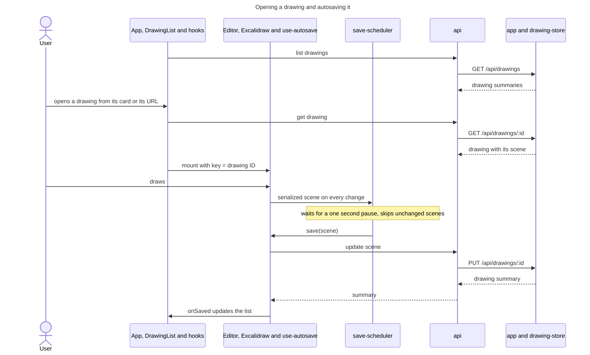
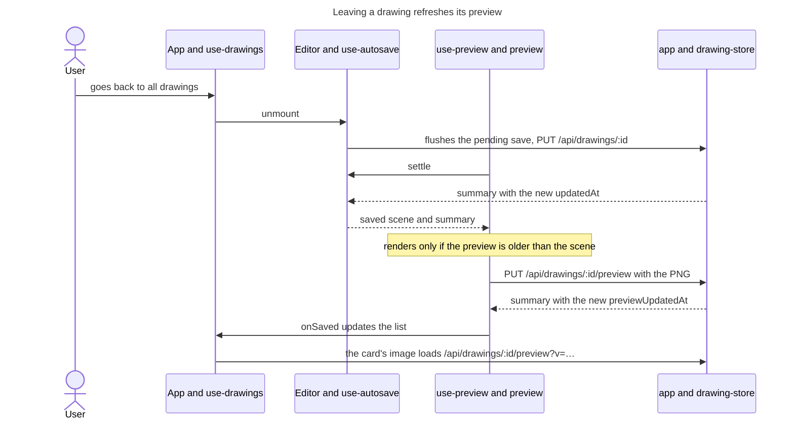
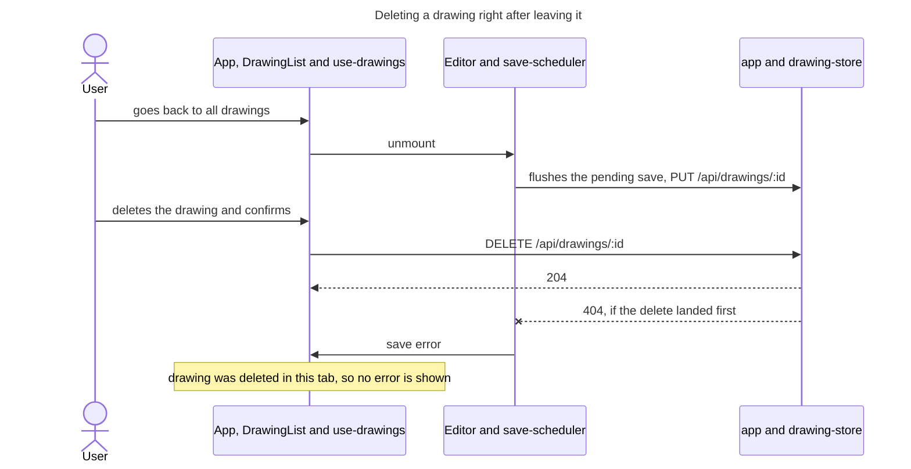

# excalidraw-dashboard architecture

excalidraw-dashboard is a self-hosted Excalidraw for one user, with a list of
named drawings. A React client embeds `@excalidraw/excalidraw` and autosaves
each drawing to a small Hono server, which stores it in SQLite through
`node:sqlite`. Node 24 runs the server's TypeScript directly; only the client
has a build step. Each drawing can have a preview image, whose URL carries a
version ([ADR 0001](adr/0001-version-preview-urls.md)).

## Domain language

- **Drawing**: an entity with an ID, a name, timestamps and a scene. It is the
  aggregate root: its name and scene change only through the drawing.
- **Scene**: a value object, the Excalidraw scene serialized with
  `serializeAsJSON(..., "local")`. It matches an exported `.excalidraw` file. A
  new drawing has no scene yet.
- **Preview**: a PNG image of a drawing's scene. It is a value object that
  belongs to the drawing; setting a new one replaces it. `previewUpdatedAt`
  records when it was last set.
- **Drawing summary**: a drawing without its scene or preview image, as a card
  on the landing page shows it.

## Context

Excalidraw's code is bundled into the client, so it isn't an external system.
Its canvas fonts are not: no asset path is set, so Excalidraw loads them from
esm.sh when the canvas shows text.

The database holds every drawing. A file copy of `DATA_DIR` is a consistent
backup only while the server is stopped; a live backup uses SQLite's
`VACUUM INTO`. The browser stores nothing; the URL names the open drawing.

## Processes

In development, `pnpm dev` starts the server with `node --watch` and the Vite
dev server for the client, which proxies `/api` to the server. In production,
the server also serves the Vite build from `./dist` and answers every other path
outside `/api/` with `index.html`, so the client handles its own URLs, such as
`/drawings/<id>`. An unknown path under `/api/` gets a 404. The
[`Dockerfile`](../../Dockerfile) packages this production server: it builds the
client in one stage and runs `src/server/index.ts` on Node 24 as the `node`
user, with the database in `/data`.

## Modules and dependencies

The Fallow zones in [`.fallowrc.json`](../../.fallowrc.json) enforce these
rules, and `pnpm fallow:architecture` fails on a forbidden import. `e2e` may
import nothing from `src/`.

`drawing-store` is the repository for drawings; no other module contains SQL.
A drawing row holds the name, the timestamps, the scene as JSON text and the
preview as a BLOB. Only the preview route reads the BLOB. When the repository
opens a database created before previews, it adds the missing columns.
`index` is the composition root and holds no logic worth testing. Nothing
enforces the dependencies inside the server beyond code review.

[`src/client/main.tsx`](../../src/client/main.tsx) is the composition root: it
renders `App` and loads `styles.css`. `src/client/drawings/` is the drawings
feature, one bounded context around the `Drawing` aggregate. It has two modules:
`catalog/` lists, creates, renames, deletes and switches drawings, and `editor/` edits the
open one and keeps its scene and preview saved. They don't import each other;
both use `api.ts` at the root. `search.ts`, a domain service that finds
drawings by a part of their name, sits at the root too. So does
`use-open-drawing-id.ts`,
and `App` uses it to track the open drawing: `/drawings/<id>` opens a drawing,
and `/` opens none. `App` shows the landing page at `/` and the editor view
otherwise: the editor below a bar with an "All drawings" link and the drawing's
name. Cards and "All drawings" are `DrawingLink`s: real links to a drawing's
path, so a middle click opens a new tab, while a plain click opens the drawing
without loading the page. Any client module may import `shared`; the diagrams
show only `api`, the main user. Nothing enforces the dependencies inside the
client beyond code review.

`App` loads the open drawing with `use-drawing` and renders `Editor` with it.
`Editor` only renders Excalidraw; the two hooks hold its behavior. `use-preview`
gets the saved scene from `use-autosave` through `settle`, which `Editor` passes
in, so it doesn't import `use-autosave` beyond a type. A preview is out of date
when the drawing has none or when it's older than the last scene save, and only
then is it rendered: a light PNG, at most 640 px on the longer side, from
Excalidraw's `exportToBlob`. A scene with nothing visible removes the preview. A
failed preview is only logged, and the next open tries again.

`App` renders `DrawingList` with the list from `use-drawings`. A search field
next to the heading filters the cards through `search.ts`, and a status says
when no drawing has the name. The first card
is a blank sheet that asks for a name and opens the new drawing. Every other
card shows the drawing's preview on a sheet, with an `` whose URL from
`api.ts` carries `previewUpdatedAt` as a version. A drawing without a preview,
or one whose preview fails to load, shows a blank sheet. Leaving a drawing
sends its new preview's summary to `use-drawings`, so the card changes its URL
and the browser loads the new image. A card renames its drawing through
`NameField` and deletes it only after `DeleteConfirmation`. `use-drawings`
remembers which drawings it deleted, so `App` can ignore a last save that was
still in flight and fails once the drawing is gone. `App` takes the icons for
its bar from `icons`.

The editor view's bar has a "Switch drawing" button, and `use-switcher-shortcut`
makes Ctrl+K or ⌘K toggle the same `QuickSwitcher` while the editor view is
mounted. The hook listens in the capture phase and stops the event, so Excalidraw
doesn't add a link on those keys. The switcher belongs to the catalog even though
it shows over the editor, because it finds and creates drawings. It is a native
modal `<dialog>`: the browser shows it above Excalidraw's layers, makes the page
behind it inert and returns the focus when it closes. It stops key events at the
dialog, and it sits outside Excalidraw's container, so they don't reach
Excalidraw's shortcuts. It lists the
matches from `search.ts` by `updatedAt`, newest first, and last offers to create
the query as a new drawing unless a drawing has that name. Choosing a row calls
`App`, which opens or creates the drawing as the landing page does. The editor
remounts on `key={drawing.id}`, so its pending save is flushed as when leaving
through "All drawings".

[`styles.css`](../../src/client/styles.css) holds what the whole client shares:
design tokens for colors from open-color, the palette Excalidraw draws with, and
for font sizes, line heights, font weights, stroke widths, corner radii and
spacing;
Excalidraw's bundled fonts, Excalifont for drawing names and Assistant for
controls; the base rules; and the focus ring. It switches to a dark palette with
`prefers-color-scheme`. Each component keeps its own rules in a CSS module next
to it, such as `DrawingList.module.css`, so its class names can't clash with
another component's. `PreviewImage`'s module gives previews, which are stored
light, Excalidraw's own canvas filter in dark mode. `use-color-scheme` reads the
same setting for `App`, which passes it to `Editor`. `Editor` hands it to
Excalidraw and hides Excalidraw's own theme toggle. The theme is display state
only: Excalidraw leaves it out of the stored scene, so a theme change saves
nothing.

## Runtime flow

`App, DrawingList and hooks` folds `App`, `DrawingList`, `use-drawing` and
`use-drawings` into one lane.
`save-scheduler` imports nothing; `use-autosave` gives it the function that
saves. Going back to all drawings or leaving the page flushes a pending save,
and reopening the drawing loads its scene again. Saves run one at a time: the
server keeps whichever write lands last, so a newer scene waits for the save in
flight.

The same check runs when a drawing opens, which gives drawings saved before
previews existed a preview and repairs one a closed tab left out of date. The
browser seldom finishes an export during `pagehide`, so that path is best
effort. Both lanes call the server through `api`, which this diagram leaves out.

Both lanes call the server through `api`, which this diagram leaves out. A save
that fails because another tab deleted the drawing still shows an error, because
the edit is lost.

## HTTP API

| Route                       | Method | Purpose                                         |
| --------------------------- | ------ | ----------------------------------------------- |
| `/api/drawings`             | GET    | List drawing summaries, sorted by name          |
| `/api/drawings`             | POST   | Create a drawing; a blank name becomes Untitled |
| `/api/drawings/:id`         | GET    | Get a drawing with its scene                    |
| `/api/drawings/:id`         | PUT    | Change the name, the scene or both              |
| `/api/drawings/:id`         | DELETE | Delete a drawing                                |
| `/api/drawings/:id/preview` | GET    | The PNG preview, cached as immutable            |
| `/api/drawings/:id/preview` | PUT    | Store an `image/png` body of at most 2 MB       |
| `/api/drawings/:id/preview` | DELETE | Remove the preview                              |

Unknown drawings, and a drawing without a preview, answer 404. Preview uploads
answer 415 for another content type and 413 above 2 MB. The `PUT` and `DELETE`
on a preview return the drawing summary; they change `previewUpdatedAt`, not
`updatedAt`. Clients are to add `?v=<previewUpdatedAt>` to the preview URL ([ADR
0001](adr/0001-version-preview-urls.md)). Scenes have no body limit, because
scenes with embedded images can be large.
[`src/shared/types.ts`](../../src/shared/types.ts) holds the request and
response types.

## Configuration

| Variable   | Default  | Purpose                                              |
| ---------- | -------- | ---------------------------------------------------- |
| `PORT`     | `3001`   | HTTP port                                            |
| `DATA_DIR` | `./data` | Directory of `drawings.db`                           |
| `NODE_ENV` | unset    | `production` makes the server serve `./dist` as well |

## Tests and quality gates

Vitest runs two projects from [`vite.config.ts`](../../vite.config.ts):
- `server` tests the API through `app.request` against an in-memory SQLite
  database. `drawing-store.test.ts` opens a database file with the schema from
  before previews, in a temporary folder, to test the upgrade.
- `client` tests in jsdom with Testing Library. Component tests mock `api.ts`
  and replace `Editor.tsx`, since Excalidraw does not render in jsdom. The
  editor hooks and `preview.ts` are tested with `api.ts` and Excalidraw's
  `exportToBlob` mocked.

`pnpm check` runs the typecheck, Biome lint and formatting, a Stylelint check
that CSS modules use the design tokens, Vitest, the production build and the
Fallow gates: dead code, duplicates, zone boundaries and health with a CRAP
limit of 12. For health, `pnpm coverage` first writes
`coverage/coverage-final.json`, which Fallow reads for the CRAP scores.

`pnpm mutation` runs mutation testing on changed code against `origin/main` and
fails below the minimum score set in the `mutation` script. CI runs it on pull
requests.

Playwright runs the end-to-end tests in [`e2e/`](../../e2e/) against the real
application: the production build, the server, SQLite and Excalidraw in
Chromium.
- [`playwright.config.ts`](../../playwright.config.ts) builds the client and
  starts the server on port 3101 with `DATA_DIR=.e2e-data`. The folder is
  deleted before each run and kept afterwards for debugging. The tests share
  this server and run one at a time.
- [`drawings.spec.ts`](../../e2e/drawings.spec.ts) covers creating, renaming and
  deleting a drawing, opening one from its card or its URL, retracing drawings
  and the landing page with the browser's back button, a drawing surviving a
  reload, storing a preview when the user leaves a drawing or opens one that has
  none and showing it on the card, reopening a drawing right after leaving it,
  following the system's dark mode, searching the drawings by name, and showing
  a failed save. The reload test reads the saved scene from the API, then
  selects all shapes in the editor to show the scene was loaded back. The
  failed-save test deletes the open drawing through the API, as another tab
  would, then dismisses the error message above the editor. The preview-on-open
  test copies a drawn scene into a drawing created through the API, so that
  drawing has no preview yet.
- [`app.spec.ts`](../../e2e/app.spec.ts) checks that the page names the
  Excalidraw logo as its icon and that the server serves it as an SVG.
- Each test groups its actions and checks into `test.step` blocks, so the test
  and its report read as a scenario.
- [`drawings-ui.ts`](../../e2e/drawings-ui.ts) holds the locators and user
  actions for the drawings UI, and
  [`drawings-api.ts`](../../e2e/drawings-api.ts) creates and deletes drawings,
  stores scenes, and reads stored scenes and previews through the HTTP API. Neither defines steps.

The tests are black-box. They run with `pnpm e2e` and in the `e2e` CI job, not
in `pnpm check`.

## Decisions

The [ADR index](adr/README.md) records the decisions behind this design as they
are made.
